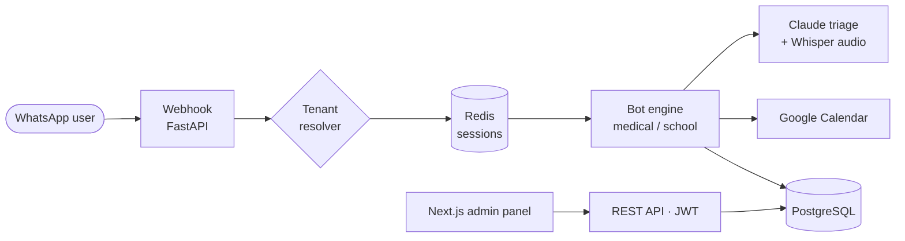
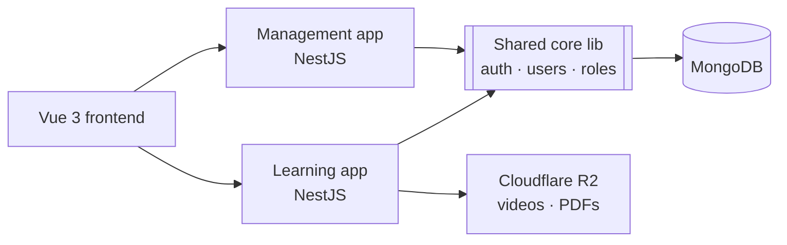

# Leandro Arévalo

📍 San Miguel de Tucumán, Argentina &nbsp;·&nbsp; 🗣️ Spanish (native) · English (advanced) &nbsp;·&nbsp; 📫 [leaarevalotuc@gmail.com](mailto:leaarevalotuc@gmail.com) &nbsp;·&nbsp; 💼 [LinkedIn](https://www.linkedin.com/in/leaarevalo/)

---

## 👋 About me

Senior Full-Stack Developer with **6+ years** building production systems with **TypeScript, Node.js/NestJS and React/Next.js** on Azure, GCP and Docker.
By day I lead an engineering team on a high-traffic **airline commerce platform**. On my own time I build and operate **AI products with real users**.
I use Claude Code and Gemini daily, and I care about tested, maintainable code.

---

## 🚀 Projects in production

> Both projects are built solo, run with real users, and live in **private repositories**. Code walkthroughs available on request.

### 💬 WA Platform: WhatsApp assistants for businesses

Multi-tenant platform that lets clinics and schools run a WhatsApp assistant: it books appointments in Google Calendar, answers institutional questions, and hands off to a human when needed.

- 🤖 **LLM integration:** Claude with structured output classifies intent and urgency; Whisper transcribes voice notes. Enabled per client, with a daily cap and automatic fallback to classic menus.
- 🏢 **Multi-tenant by design:** per-client config, roles (client / superadmin) and a self-serve WhatsApp connection flow.
- ✅ **60+ pytest tests**, Alembic migrations, Docker, Railway.

  

### 🎓 ICE: Management & Learning Platform

Church management and academic platform, delivered as **two independently deployable apps** that share one core library (one login across both).

- 🔐 **Security:** role-based authorization, JWT, rate limiting, AES-256-GCM encryption for sensitive records.
- 📚 **Learning features:** signed-URL video delivery, PDF materials, server-scored quizzes.
- ✅ Jest test suites, DTO validation, monorepo architecture.

  

---

## 🛠️ Tech stack

   
  

| | |
|---|---|
| **AI** | LLM integration (Claude API structured output, Whisper), Claude Code, Gemini Code, MCP |
| **Backend** | TypeScript, Node.js, NestJS, Python (FastAPI), REST, microservices, RabbitMQ |
| **Frontend** | React, Next.js, Vue.js (Pinia), Tailwind CSS |
| **Cloud & DevOps** | Azure (API Management, Key Vault), GCP, AWS (fundamentals), Docker, CI/CD |
| **Testing** | Jest, pytest |

---

## 💼 Experience

<b>Senior Full-Stack Developer · Sky Airline (Ancillaries Platform)</b> &nbsp;|&nbsp; 2021 – present

 

Engaged through ACID Labs (2021–2025) and Qurable (2025–present).

- Built **NDC** flows (shopping, order management, servicing) in a company-wide migration between two airline reservation providers.
- Optimized purchase flows (seats, baggage) for latency under high concurrency.
- Designed third-party integration APIs secured with Azure API Management and Key Vault.
- Automated loyalty point accreditation based on customer purchase behavior.
- Lead the engineering team since 2025.

<b>Full Stack Developer · Plerk</b> &nbsp;|&nbsp; 2020 – 2021

 

- Frontend of a B2B corporate-benefits platform (Vue.js, Node.js).
- Secure onboarding with automated KYC validations.

---

## 📊 GitHub activity

  
  

Stats include private contributions only if enabled in the profile settings.

---

**Open to remote Full-Stack and AI Engineering roles.** &nbsp; 📫 [Email](mailto:leaarevalotuc@gmail.com) &nbsp;·&nbsp; 💼 [LinkedIn](https://www.linkedin.com/in/leaarevalo/)

